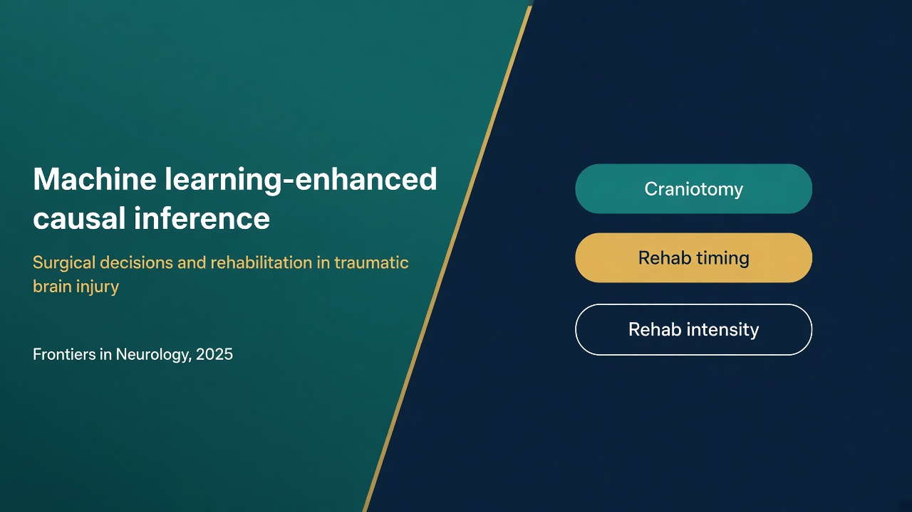
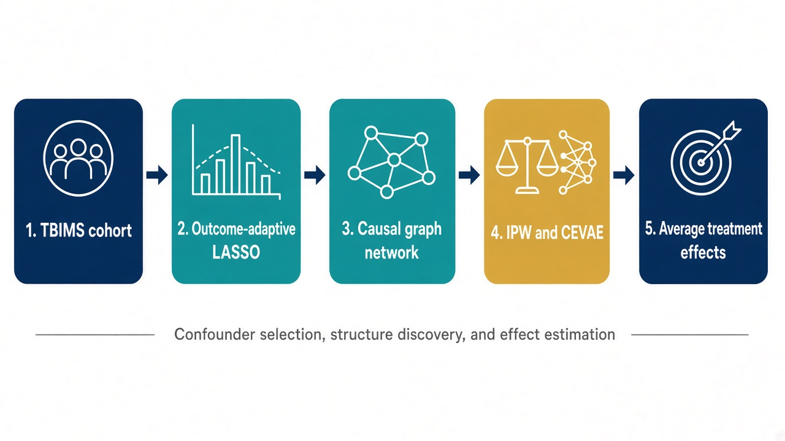

<p align="center">
  
</p>

<p align="center">
  <a href="https://doi.org/10.3389/fneur.2025.1685335"></a>
  <a href="https://doi.org/10.3389/fneur.2025.1685335"></a>
  <a href="https://www.frontiersin.org/journals/neurology/articles/10.3389/fneur.2025.1685335/full"></a>
  <a href="https://www.tbindsc.org/"></a>
  
</p>

# Machine learning-enhanced causal inference of surgical decisions and rehabilitation strategies in traumatic brain injury

Code and study notes for the paper:

> Irankhah E, Pagare M, Chetla L, Shen J, Ul Alam MA, Wolkowicz KL. Machine learning-enhanced causal inference of surgical decisions and rehabilitation strategies in traumatic brain injury. *Frontiers in Neurology*. 2025;16:1685335. [https://doi.org/10.3389/fneur.2025.1685335](https://doi.org/10.3389/fneur.2025.1685335)

The question is the effect of three decisions in moderate-to-severe traumatic brain injury: craniotomy, very early versus delayed rehabilitation, and short versus long rehabilitation stays. Outcomes are discharge Functional Independence Measure scores and later productivity, participation, and life satisfaction.

## What the paper found

The source database is the U.S. Traumatic Brain Injury Model Systems National Database, 79,604 patients. Each question uses its own analytic subset.

| Question | Contrast | Analytic sample | Direction reported in the paper |
| --- | --- | --- | --- |
| Craniotomy | Required craniotomy versus no craniotomy | 302 treated and 371 untreated | Lower discharge FIM scores. OAL and IPW average effects about −0.10 to −0.17 on 1–7 scales |
| Rehabilitation timing | Start within 4.5 days versus start at 45 days or later | 4,620 very early and 2,722 delayed | Higher follow-up productivity and life satisfaction. Average effects about +0.03 to +0.09 on 0–1 scales |
| Rehabilitation intensity | Short stay versus long stay | 1,718 short and 1,249 long | Longer stays had the largest positive effects, about +0.08 to +0.24 |

Full estimates, confidence intervals, and p-values are in Tables 1–3 of the paper. The paper treats the surgical result as compatible with confounding by indication: patients who need craniotomy are more severely injured. Effects that are statistically detectable can still be small for an individual patient.

<p align="center">
  
</p>

## Methods in the paper

1. **Outcome-adaptive LASSO** selects confounders for each outcome.
2. **A causal graph neural network** checks the structure of those variables. The paper keeps a consensus set of 25 confounders.
3. **Inverse probability weighting** estimates the average treatment effect from the measured confounders. Weights are trimmed at the 1st and 99th percentiles.
4. **A causal-effect variational autoencoder** estimates the effect while allowing for latent confounding.

Treatment-assignment models in the paper are logistic regression, random forest, support vector machine, XGBoost, and naive Bayes. The paper reports average accuracy of at least 90 percent, which it reads as strong confounding by indication rather than as proof that the treatment effect is identified.

## What is in this repository

| File | Role |
| --- | --- |
| `Final_Analysis.ipynb` | Stratified average effects, average effects on the treated, propensity-score matching, and Welch tests for the surgical FIM outcomes |
| `preprocess_data.py` | Builds `severity_control_processed.csv` |
| `severity_control_processed.csv` | Derived analysis table used by the notebook |

The notebook is an earlier surgical analysis. It stratifies and matches on sex, spinal cord injury, and hypertension, and it reports Welch tests. It does not implement outcome-adaptive LASSO, the causal graph network, inverse probability weighting, or the variational autoencoder. Its estimates are not the estimates in Table 1 of the paper. Use the paper for the published results.

## Data access

The TBIMS National Database is not public. A request and a data-use agreement go through the [Traumatic Brain Injury Model Systems National Data and Statistical Center](https://www.tbindsc.org/). The study used a de-identified extract approved by that center on 25 January 2025. The University of Massachusetts Lowell determined the project was not human-subjects research.

Do not commit a raw TBIMS extract. If `severity_control_processed.csv` contains patient-level rows, confirm with the data-use agreement that this derived file may remain in a public repository.

## Run the notebook

```powershell
python -m venv .venv
.\.venv\Scripts\Activate.ps1
pip install -r requirements.txt
jupyter lab Final_Analysis.ipynb
```

Python 3.8 or newer.

## Citation

```bibtex
@article{irankhah2025tbi,
  author  = {Irankhah, Elyas and Pagare, Madhavi and Chetla, Lokesh and Shen, Jiabin and Ul Alam, Mohammad Arif and Wolkowicz, Kelilah L.},
  title   = {Machine learning-enhanced causal inference of surgical decisions and rehabilitation strategies in traumatic brain injury},
  journal = {Frontiers in Neurology},
  year    = {2025},
  volume  = {16},
  pages   = {1685335},
  doi     = {10.3389/fneur.2025.1685335}
}
```

## Acknowledgments

TBIMS data are funded by the National Institute on Disability, Independent Living, and Rehabilitation Research, Administration for Community Living, U.S. Department of Health and Human Services. The paper received no separate publication funding.
